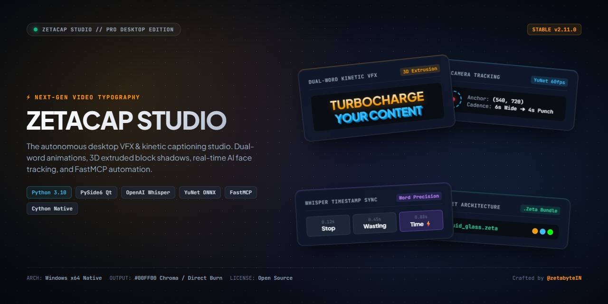

<div align="center">

# 🎬 ZetaCap Studio — Modern AI Captioning & VFX Suite



[](#)
[](https://www.python.org/)
[](https://wiki.qt.io/Qt_for_Python)
[](#)
[](#)
[](https://paypal.me/zetabyteIN)

### *Production-Grade Kinetic Captions, 3D Typography, AI Face-Tracking, and FastMCP Automation*

</div>

---

## 🌟 Overview

**ZetaCap Studio** is an autonomous desktop application for creators and video editors who want studio-quality, high-retention video captions inspired by top creators (Alex Hormozi, Iman Gadzhi, Ali Abdaal). Built natively in **Python 3.10** with **PySide6 (Qt)** and compiled through **Cython** for maximum rendering throughput.

Unlike basic web subtitle generators, ZetaCap operates 100% locally on your machine—rendering dual-word kinetic animations, custom 3-stop RGB gradients, specular gloss sheen, 3D extruded block shadows, intelligent camera cadence, and solid `#00FF00` chroma key output for DaVinci Resolve, Premiere Pro, Final Cut, and CapCut.

---

## ✨ Key Features

### 🎨 1. Dual-Word Kinetic Typography & 3D VFX
- **Kinetic Word Animations**: High-energy dual-word stacked animations synced to speech cadence.
- **3-Stop Color Gradients**: Customizable Top, Middle, and Bottom RGB color stops for both Top and Bottom text lines.
- **Specular Sheen & Gloss Controls**: Metallic and glass sheen slider (`0.0` to `2.5`) with scope selection (Top Word, Bottom Word, or Full Caption).
- **3D Extrusion Shadows**: Directional extruded block shadow engine with independent X/Y offset controls and shadow depth scaling.
- **Custom Fonts**: Pre-loaded with *Poppins Bold*, *Helvetica Bold*, *Helvetica Oblique*, *SF Pro Display*, *Fraunces*, or upload any custom `.ttf`/`.otf` file.

### 🤖 2. Local AI Speech Transcription (OpenAI Whisper)
- **Word-Level Millisecond Sync**: Powered by `whisper-timestamped` for zero-drift alignment.
- **Interactive Word Editor**: Review and rectify words, fix phonetic misspellings, adjust proper nouns, or insert emojis before final export.
- **Local Model Caching**: Automatically manages and caches models (`tiny`, `base`, `small`, `medium`) locally in `D:\ai_models\whisper`.
- **Dynamic Chunking**: Configurable words-per-chunk, characters-per-line, and vertical distance scale sliders.

### 📸 3. Intelligent AI Face Tracking & Cinematic Auto-Zoom
- **Dual Neural Face Detectors**: Primary OpenCV YuNet deep neural network (`face_detection_yunet_2023mar.onnx`) with Haar Cascade fallback.
- **Quintic Smootherstep S-Curves**: Glides virtual camera anchors smoothly without jarring cuts or robotic pan snaps.
- **Intelligent Cadence Timing**: Calibrated *Stay Wide (6.0s) ➔ Punch-In Close-Up (4.0s)* pacing to keep viewer retention high.
- **Rock-Steady Anchor Locking**: Averages coordinates during zoom holds to eliminate face jitter and head drift.

### 🟩 4. Chroma Key Green Screen & Direct Burn Outputs
- **`#00FF00` Green Screen**: Perfectly rendered chroma green background for drag-and-drop 1-click *Ultra Key / Chroma Key* in Adobe Premiere Pro, DaVinci Resolve, CapCut, or Final Cut Pro.
- **Direct Video Hardsubs**: Burn captions and camera zoom framing directly into source MP4/MOV videos.
- **Preserved Audio Timeline**: Exports lossless original audio tracks alongside video for instant timeline snapping.

### 🎛️ 5. Preset Architecture (`.zeta` & `.json`)
- Save, load, and share your complete visual styling across 30+ typography, shadow, VFX, and camera tracking parameters.
- Multi-preset alternating pool: cycle between distinct visual looks across consecutive sentences.

### 🔌 6. FastMCP Automation Protocol
- Built-in Model Context Protocol server (`project/mcp_server.py`) allowing AI coding agents and external automation scripts to inspect, transcribe, rectify, and render videos programmatically via:
  ```bash
  python run.py --mcp
  ```

---

## 💖 Support the Creator

If ZetaCap Studio saves you hours of manual editing or powers your content workflow, consider supporting the ongoing development:

[](https://paypal.me/zetabyteIN)

- **PayPal Handle:** [@zetabyteIN](https://paypal.me/zetabyteIN)
- **Direct Link:** [paypal.me/zetabyteIN](https://paypal.me/zetabyteIN)

Your support helps maintain dependencies, build new animation engines, and keep the application actively updated!

---

## 🚀 Quickstart & Installation

### Prerequisites
- **Operating System**: Windows 10/11 (64-bit)
- **Python**: 3.10.x recommended
- **Hardware**: Dedicated GPU recommended for fastest Whisper and video compositing passes (NVIDIA CUDA or modern AMD/Intel).
- **FFmpeg**: Installed and accessible in your system `PATH`.

### 1. Clone the Repository
```bash
git clone https://github.com/Fazzbro/ZetaCap-Studio.git
cd ZetaCap-Studio
```

### 2. Set Up Virtual Environment
```bash
python -m venv .venv
.venv\Scripts\activate
```

### 3. Install Dependencies
```bash
pip install -r requirements.txt
```

### 4. Run the Studio
```bash
python run.py
```

Or run the headless MCP server for AI agent automation:
```bash
python run.py --mcp
```

---

## 🛠️ Compiling Standalone Binaries (Developers)

To compile the Cython `.pyd` core extensions and package a standalone Windows executable (`dist/ZetaCap/ZetaCap.exe`):

```bash
# 1. Compile Cython extensions and build standalone PyInstaller bundle
python build_manager.py

# 2. (Optional) Compile Inno Setup installer package
# Ensure Inno Setup 6/7 (ISCC.exe) is installed
& "ISCC.exe" installer.iss
```

---

## 📁 Repository Structure

```
captions/
├── project/
│   ├── app.py                     # Main application entry point & setup
│   ├── cython_imports.py          # PyInstaller Cython hook declarations
│   ├── mcp_server.py              # FastMCP automation interface
│   ├── core/
│   │   ├── config.py              # Persistent user configuration & paths
│   │   └── hardware_utils.py      # System hardware identification helpers
│   ├── services/
│   │   ├── backend_renderer.py    # Core compositing & text rendering engine
│   │   ├── caption_service.py     # Whisper transcription & chunk parsing
│   │   ├── color_grading.py       # 3D LUT color grading integration
│   │   ├── preset_choreographer.py# .zeta & .json preset serialization
│   │   ├── silence_service.py     # Audio silence detection & volume gating
│   │   ├── text_effect.py         # Advanced typography effects
│   │   └── video_service.py       # Video probe & format management
│   ├── ui/
│   │   ├── main_window.py         # Primary PySide6 Studio layout & dockables
│   │   ├── settings_panel.py      # Tabbed typography & VFX controls
│   │   ├── components.py          # Custom Qt color buttons, sliders, & tabs
│   │   └── themes/                # Dark theme stylesheets (.qss)
│   └── workers/
│       ├── render_worker.py       # Background QThread rendering worker
│       ├── transcription_worker.py# Background Whisper transcription thread
│       └── face_detection_worker.py# Face tracking analysis worker
├── presets/                       # Factory `.zeta` style bundles
├── assets/                        # Social preview cards & UI assets
├── banner/                        # Source HyperFrames composition for banners
├── build_manager.py               # Cython compilation & PyInstaller build driver
├── build_secure.py                # Cython build script
├── ZetaCap.spec                   # PyInstaller specification file
├── installer.iss                  # Inno Setup installer script
└── run.py                         # Application bootstrapper
```

---

## 📄 License & Attribution

- **License**: Released for creator empowerment and open development.
- **Creator & Maintainer**: **@zetabyteIN** ([Support on PayPal](https://paypal.me/zetabyteIN))
